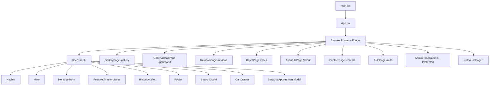

# Nisa Frontend - Complete Analysis & Rules Document

## Project Ka Overview

**Project Name:** Khalil & Sons - Luxury Jewellery Business Website
**Tech Stack:** React 19 + Vite 8 + Tailwind CSS 4 + shadcn/ui (JavaScript/JSX - koi TypeScript NAHI)
**Architecture:** Modular component-based (Admin Panel + User Panel)

---

## Mandatory Rules (Har Task Main Follow Karna LAZMI Hai)

### Rule 1: Modular Architecture & File Size Limits
- **Folder structure strictly follow karna hai** - Client/Server alag alag
- **Frontend components chhote reusable banane hain** - kabhi bhi 1200-1300 lines ka massive file NAHI banana
- **Server file 120 lines se zyada NAHI** - sirf unavoidable case main exceed karo

### Rule 2: Fully Functional & Secure Code
- **Koi dummy data ya placeholder NAHI** - sab kuch real functional hona chahiye
- **Security vulnerabilities ZERO** - production-ready code likhna hai

### Rule 3: Clean Code
- **Code main koi COMMENTS NAHI likhne** - bilkul bhi nahi

### Rule 4: UI & Design Standards
- **Professional icons use karne hain** - generic AI-generated look wale NAHI
- **No Generic AI Icon Boxes / Cards:** Kabhi bhi generic AI SaaS style ke rounded icon boxes (jaise `size-10 rounded-xl bg-muted/60`, `size-12 rounded-2xl` ya icons ke peeche square/rounded muted background) poore project main use NAHI karne. Jewellery cards main authentic assay hallmark stamps (jaise `AU · 999.0`, `AU · 916.6`), clean typography aur fine luxury borders use karne hain.
- **Premium aesthetic feel** zaruri hai

### Rule 5: Task Ke Baad Suggestions
- **Har task ke baad related improvements suggest karna** (Format: Pehley Problem, Phir Us Ka Hal)
- **Agar koi issue nazar aaye toh FORAN report karna** aur fix btana

### Rule 6: Latest Versions Only
- **Sab packages latest stable version main install karne hain**

### Rule 7: No Native Alerts
- **Browser `alert()` ya `confirm()` KABHI NAHI use karna**
- **Custom Modals / Alert Dialogs use karne hain** - professional theme-aware

### Rule 8: Technology Stack Constraints
- **Sirf JavaScript / JSX use hoga** - poore project main TypeScript bilkul mana hai

### Rule 9: Communication & Language Standards
- **Roman Urdu Mandatory:** Saari communication, response, aur suggestions sirf Roman Urdu main honge

### Rule 10: Task Execution & Focus Discipline
- **Jitna kaam bola jaye sirf utna hi karna hai** - bina kahe doosre features ko bilkul nahi chherna

---

## Current Frontend Architecture

### Frontend Folder Structure

| Folder | Kaam |
|--------|------|
| `src/api/` | Backend API calls (client, endpoints, gallery, inquiry, order, product, rates, users) |
| `src/admin/` | Admin panel + admin components |
| `src/user/` | User-facing pages + components |
| `src/components/` | Shared components (auth, ui, pwa, vault, shadcn-studio) |
| `src/context/` | React Context (AppContext, LoadingContext) |
| `src/utils/` | Utility functions (phone, seo, whatsapp, ratePdfGenerator, storeStatus) |
| `src/lib/` | Library utilities (cn/utils) |

### Key Dependencies

| Package | Version | Kaam |
|---------|---------|------|
| react | ^19.3.1 | UI Framework |
| react-router-dom | ^7.18.4 | Routing |
| tailwindcss | ^4.3.3 | Styling |
| framer-motion / motion | ^14.6.0 | Animations |
| gsap | ^3.15.0 | Advanced animations |
| firebase | ^13.1.0 | Auth & Backend |
| lucide-react | ^5.7.0 | Icons |
| sonner | ^2.0.8 | Toast notifications |
| zod | ^3.25.76 | Validation |
| react-hook-form | ^7.91.0 | Form handling |
| shadcn/ui components | Latest | UI Components |

---

## Existing Features Analysis

### User Side Features (Jo Already Lag Chuki Hain)

| # | Feature | Files | Status |
|---|---------|-------|--------|
| 1 | **Home Page** (Hero, Heritage, Featured, Atelier) | UserPanel.jsx, Hero.jsx, HeritageStory.jsx, FeaturedMasterpieces.jsx, HistoricAtelier.jsx | ✅ Working |
| 2 | **Gallery** (Categories, Pagination, Detail) | GalleryPage.jsx, GalleryDetailPage.jsx, GalleryPagination.jsx | ✅ Working |
| 3 | **Reviews System** | ReviewsPage.jsx, GalleryReviewsSection.jsx, MasterpieceReviewModal.jsx | ✅ Working |
| 4 | **Gold Rates** (Calculator, Table, Knowledge) | RatesPage.jsx, rates/*.jsx (5 components) | ✅ Working |
| 5 | **About Us Page** | AboutUsPage.jsx + shadcn-studio blocks | ✅ Working |
| 6 | **Contact Page** (Form, Map, Directory) | ContactPage.jsx, AtelierContactForm.jsx, AtelierInteractiveMap.jsx, AtelierContactDirectory.jsx | ✅ Working |
| 7 | **Search Modal** | SearchModal.jsx + searchData.js | ✅ Working |
| 8 | **Cart / Vault System** | CartDrawer.jsx, AtelierVaultDrawer.jsx, SaveToVaultButton.jsx | ✅ Working |
| 9 | **Auth System** (Google One Tap, Login/Signup) | AuthPage.jsx, AuthForm.jsx, GoogleOneTapOverlay.jsx, ProtectedRoute.jsx | ✅ Working |
| 10 | **PWA Support** | PWAInstallPrompt.jsx, pwaRegister.js | ✅ Working |
| 11 | **Navbar + Footer** | Navbar.jsx, Footer.jsx | ✅ Working |
| 12 | **Inquiry System** | MasterpieceInquiryModal.jsx, BespokeAppointmentModal.jsx | ✅ Working |
| 13 | **SEO Management** | utils/seo.js | ✅ Working |
| 14 | **WhatsApp Integration** | utils/whatsapp.js | ✅ Working |
| 15 | **Store Status** | StoreStatusBadge.jsx, utils/storeStatus.js | ✅ Working |

### Admin Side Features

| # | Feature | Files |
|---|---------|-------|
| 1 | **Dashboard Overview** | DashboardOverview.jsx, AdminMetrics.jsx |
| 2 | **Gallery Management** | GalleryManagement.jsx, GalleryAdminView.jsx, EditGalleryModal.jsx |
| 3 | **Reviews Management** | ReviewsAdminView.jsx, AdminReviewsList.jsx, AddReviewModal.jsx, EditReviewModal.jsx, ReviewsMetrics.jsx |
| 4 | **Users Management** | UsersAdminView.jsx, UsersTable.jsx, UsersMetrics.jsx, UserActivityModal.jsx |
| 5 | **Rates Management** | RatesAdminView.jsx, RatesAdminHeader.jsx, RatesAdminHeroCard.jsx, RatesAdminHistoryList.jsx, RatesBroadcastModal.jsx |
| 6 | **Inquiries Management** | InquiriesAdminView.jsx, AtelierInquiries.jsx, ReplyInquiryModal.jsx |
| 7 | **Confirm Modals** | ConfirmDeleteModal.jsx, ConfirmRoleModal.jsx, ConfirmStatusModal.jsx |

---

## Existing Features Ki Problems & Suggestions

### 🔴 Problem 1: AppContext Use Nahi Ho Raha
**Problem:** `AppContext.jsx` main cart, navigation, alert sab defined hai lekin `UserPanel.jsx` apna local state use kar raha hai cart ke liye. Yeh duplication hai.
**Hal:** Ya toh `AppContext` hatao ya phir `UserPanel.jsx` ko `AppContext` se connect karo. Ek jagah state honi chahiye.

### 🔴 Problem 2: Duplicate Route Paths
**Problem:** `App.jsx` main same pages ke multiple routes hain: `/gallery` + `/collections`, `/about` + `/about-us` + `/about-us-page-30`, `/contact` + `/contact-us`, `/rates` + `/gold-rates`, `/auth` + `/login` + `/signup`
**Hal:** SEO ke liye redirects use karo `<Navigate to="/gallery" replace />` warna search engines penalize karengi duplicate content ke liye.

### 🟡 Problem 3: Design Token System Incomplete
**Problem:** `index.css` main kuch colors hardcoded hain (`#755a23`, `#c1a162`, `#f9f9f9`, `#2d3435`) jo CSS variables main nahi hain. Yeh inconsistency create karta hai.
**Hal:** Sab brand colors ko CSS custom properties main rakhna chahiye taake ek jagah se manage ho.

### 🟡 Problem 4: Animation Libraries Duplicate
**Problem:** `framer-motion` AUR `motion` dono install hain + `gsap` bhi. `framer-motion` aur `motion` essentially same package hain v14+.
**Hal:** Ek hatao. `motion` (latest) rakhna chahiye, `framer-motion` dependency remove karo.

### 🟢 Problem 5: Unused Components
**Problem:** `sheard.jsx` file hai jo likely spelling mistake hai `shared.jsx` ki. Aisi dead files codebase confuse karti hain.
**Hal:** Verify karo kahan use ho raha hai, agar nahi toh remove karo.

### 🟢 Problem 6: `cn` Package Duplicate
**Problem:** `cn` npm package install hai (`^0.5.0`) jabke `src/lib/utils.js` main already `clsx + tailwind-merge` se custom `cn` function bana hua hai, aur Vite config main alias bhi hai.
**Hal:** `cn` npm package hatao, sirf local `utils.js` wala use karo.

---

## Kaam Karne Ka Tareeqa (Workflow Rules)

> [!IMPORTANT]
> Har naya feature implement karte waqt yeh steps LAZMI follow karne hain:

1. **Pehle analyse karo** - kya cheez already exist karti hai, kahan fit hogi
2. **Existing folder structure follow karo** - `src/user/components/`, `src/user/pages/`, `src/admin/components/`
3. **Components chhote rakhna** - har distinct UI part alag file main
4. **JavaScript/JSX SIRF** - TypeScript use NAHI hona
5. **No comments** - clean code likhna
6. **Professional icons** - lucide-react ya react-icons se
7. **Custom modals** - native alerts KABHI nahi
8. **Response ROMAN URDU main dena**
9. **Sirf wo feature karna jo bola jaye** - baqi features ko NAHI cherna
10. **Kam files main smart kaam** - architecture sahi rakhna

---

## Design System (Current Theme)

| Token | Value | Use |
|-------|-------|-----|
| **Headline Font** | Newsreader, serif | Headings, titles |
| **Body Font** | Work Sans, sans-serif | Body text, labels |
| **Primary Gold** | `#755a23` → `#c1a162` gradient | Hero, CTAs |
| **Background** | `#f9f9f9` | Page bg |
| **Text Primary** | `#2d3435` | Main text |
| **Text Secondary** | `#5a6061` | Subtle text |
| **Border** | `#e4e4e7` | Dividers |
| **Error** | `#9f403d` | Error states |

> [!NOTE]
> Yeh ek luxury jewellery brand ki website hai. Design premium, elegant, aur gold-themed hona chahiye. Generic AI look se bachna hai.
